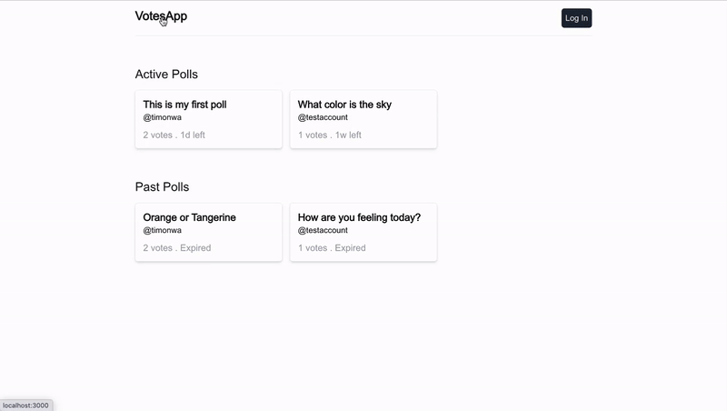

<div align="center">


<br />
<br />

# Real-Time Polling App with Permit.io

### A Next.js polling app with Supabase and role-based access control

A Next.js and Supabase polling app where Permit.io controls who can view, create, vote on, edit and delete polls. Anonymous users can only view; signed-in users can create polls and vote.

<br />

[![Built by Studio1](https://img.shields.io/badge/Built_by_Studio1-f97316?style=for-the-badge&logo=data%3Aimage%2Fsvg%2Bxml%3Bbase64%2CPHN2ZyB4bWxucz0iaHR0cDovL3d3dy53My5vcmcvMjAwMC9zdmciIHZpZXdCb3g9IjAgMCAxNjAgMTYwIiBmaWxsPSJub25lIj48cGF0aCBmaWxsLXJ1bGU9ImV2ZW5vZGQiIGNsaXAtcnVsZT0iZXZlbm9kZCIgZD0iTTAgMzVDMCAxNi42ODA3IDE0LjA3NDQgMS42NDg0NCAzMiAwLjEyNjk1M1YxNDFINTEuMDUyM0M1Mi40MzA4IDEzNy4zNDQgNTQuNzQ0NiAxMzMuNjg5IDU3Ljk5MzggMTMwLjAzM0M2MS4xNDQ2IDEyNi41MDggNjQuNjg5MiAxMjMuNDQgNjguNjI3NyAxMjAuODI5QzcyLjU2NjIgMTE4LjM0OSA3Ni4zNTY5IDExNi43ODIgODAgMTE2LjEyOVY4Ni43NTQ0Qzc1LjQ3MDggODcuOTI5MiA3MS4zODQ2IDg5LjY5MTkgNjcuNzQxNSA5Mi4wNDE1QzY0IDk0LjUyMjUgNjAuNzUwOCA5Ny40NiA1Ny45OTM4IDEwMC44NTRDNTYuNTM0NSAxMDIuNzIgNTUuMjU0NSAxMDQuNjU5IDU0LjE1MzkgMTA2LjY3MVYwSDEyNUMxNDQuMzMgMCAxNjAgMTUuNjY5OSAxNjAgMzVWMTI1QzE2MCAxNDQuMzMgMTQ0LjMzIDE2MCAxMjUgMTYwSDEyNFYxOEgxMDQuOTQ4QzEwMy41NjkgMjEuNjgxNiAxMDEuMjU1IDI1LjM2MjggOTguMDA2MiAyOS4wNDQ0Qzk0Ljg1NTQgMzIuNTk0MiA5MS4zMTA4IDM1LjY4NDEgODcuMzcyMyAzOC4zMTRDODMuNDMzOCA0MC44MTIgNzkuNjQzMSA0Mi4zODk2IDc2IDQzLjA0NzRWNzIuNjMwNEM4MC41MjkyIDcxLjQ0NzMgODQuNjE1NCA2OS42NzI0IDg4LjI1ODUgNjcuMzA1N0M5MiA2NC44MDc2IDk1LjI0OTIgNjEuODQ5MSA5OC4wMDYyIDU4LjQzMDdDOTkuNDY1NSA1Ni41NTEzIDEwMC43NDUgNTQuNTk4NiAxMDEuODQ2IDUyLjU3MjNWMTYwSDM1QzE1LjY3IDE2MCAwIDE0NC4zMyAwIDEyNVYzNVoiIGZpbGw9IiNmZmZmZmYiLz48L3N2Zz4K)](https://studio1hq.com)
[](https://permit.io)
[](https://www.permit.io/blog)

[Permit.io docs](https://docs.permit.io) &nbsp;·&nbsp; [Permit.io](https://permit.io) &nbsp;·&nbsp; [More examples](https://github.com/Studio1HQ) &nbsp;·&nbsp; [studio1hq.com](https://studio1hq.com)

</div>

<br />

## Overview

This is the demo project for building a real-time polling app with Next.js, Supabase and Permit.io. It shows how to put role-based access control (RBAC) in front of a typical CRUD app.

Anonymous visitors can only view polls. Signed-in users can create polls, vote on polls they did not create, and see voting results update in real time. Only the creator of a poll can edit or delete it. The full tutorial is on the [Permit.io blog](https://www.permit.io/blog).

<p align="center"></p>

## Features

- **Role-based access control**: Permit.io decides who can view, create, vote on, edit or delete a poll.
- **Email authentication**: Supabase Auth with email sign-in.
- **Real-time results**: Voting results update live through Supabase.
- **Creator-only management**: A poll's creator gets a role on that poll after creating it, and can manage it from the manage page.
- **Poll expiry**: Each poll has an `expires_at` time and a countdown label such as "3d left" or "Expired".
- **Local PDP**: A `Dockerfile` runs the Permit.io PDP (`permitio/pdp-v2`) on port 7766.

## Tech stack

| Layer | Tool |
| --- | --- |
| Framework | [Next.js](https://nextjs.org/) 15 (Pages Router), React 19 |
| Styling | [Tailwind CSS](https://tailwindcss.com/) |
| Database and auth | [Supabase](https://supabase.com) (`@supabase/ssr`, `@supabase/supabase-js`) |
| Authorization | [Permit.io](https://permit.io) (`permitio` SDK) |
| Language | TypeScript |
| Local PDP | Docker (`permitio/pdp-v2`) |

## Getting started

### Prerequisites

- Node.js 18 or later and npm
- A Supabase project with `polls`, `options` and `votes` tables
- A Permit.io account and API key
- Docker, if you want to run the Permit.io PDP locally
- The Supabase CLI, if you run the `updateCreatorRole` edge function locally

### Installation

```bash
git clone https://github.com/Studio1HQ/realtime-polling-app-nextjs-supabase-permitio.git
cd realtime-polling-app-nextjs-supabase-permitio
npm install
```

### Environment variables

| Variable | Description |
| --- | --- |
| `NEXT_PUBLIC_SUPABASE_URL` | Your Supabase project URL, from the Supabase dashboard. |
| `NEXT_PUBLIC_SUPABASE_ANON_KEY` | Your Supabase anonymous key, from the Supabase dashboard. |

The Permit.io API key is used by the Supabase edge function, not by the Next.js app. Set it as a secret there.

### Run

```bash
npm run dev
```

Open [http://localhost:3000](http://localhost:3000). To start a local Permit.io PDP:

```bash
docker build -t permit-pdp .
docker run -p 7766:7766 permit-pdp
```

## How it works

- `pages/index.tsx` lists polls, `pages/polls/[id].tsx` shows one poll and `pages/polls/manage.tsx` is where creators manage their polls.
- `utils/supabase/` holds the four Supabase client factories (`component`, `server-props`, `static-props`, `api`) used in the browser and on the server.
- `components/NewPoll.tsx` inserts a poll and its options into Supabase, then calls the `updateCreatorRole` edge function at `http://127.0.0.1:54321/functions/v1/updateCreatorRole`. That function updates the creator's role in Permit.io. The edge function is not part of this repository.
- `helpers/index.ts` holds the poll types plus helpers for total votes and the expiry countdown.

## Resources

- [Permit.io blog](https://www.permit.io/blog): the tutorial this project accompanies.
- [Timonwa's Notes](https://tech.timonwa.com/blog): the author's blog with more technical content.
- [Permit.io docs](https://docs.permit.io): RBAC, SDKs and the PDP.
- [Permit.io](https://permit.io): the authorization platform used here.
- [Supabase documentation](https://supabase.com/docs): auth, database and real-time.
- [Next.js](https://nextjs.org/): the React framework used.

## License

Released under the [MIT License](LICENSE).

<br />

---

<div align="center">

<a href="https://studio1hq.com">
  <picture>
    <source media="(prefers-color-scheme: dark)" srcset="https://raw.githubusercontent.com/Studio1HQ/website/main/brand/studio1-logo-on-dark.svg" />
    
  </picture>
</a>

Built by **[Studio1](https://studio1hq.com)**, the technical content and DevRel partner for devtool teams. Made with [Permit.io](https://permit.io).<br />
Browse more open-source examples at [github.com/Studio1HQ](https://github.com/Studio1HQ).

[](https://studio1hq.com)
[](https://cal.com/studio1/collab)
[](https://x.com/Studio1HQ)
[](https://www.linkedin.com/company/studio1hq/)

<sub><a href="https://studio1hq.com">studio1hq.com</a> · Technical content, docs, video and DevRel for devtools</sub>

</div>
